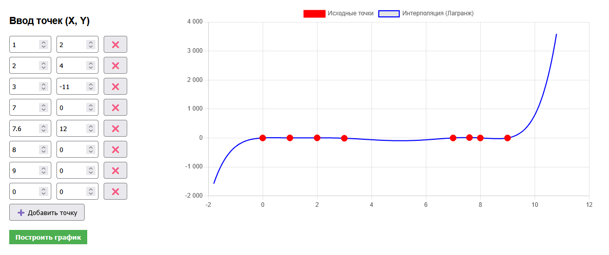
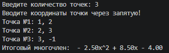

# Интерполяция по точкам (Полином Лагранжа)
Простая консольная утилита вычисляющая полином Лагранжа для любого количества точек

## Использование (Web)
```bash
go build main.go
./main.go --web 8080
```

<p align="center">
  
  <p align="center">Скриншот работы программы</p>
</p>


## Использование (CLI)
```bash
go build main.go
./main.go
```

<p align="center">
  
  <p align="center">Скриншот работы программы</p>
</p>

